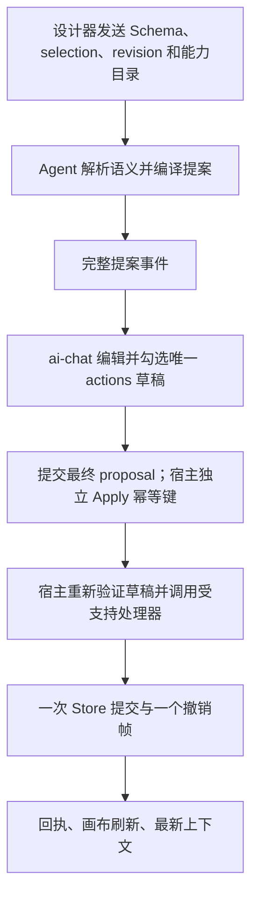

# 单一动作草稿：Agent、ai-chat 与设计器宿主接入

契约更新：2026-11-23；Agent 目标包版本：1.2.13。

**Agent 与 ai-chat 使用单一 actions 草稿；ai-chat 支持真实 context 中的 formDraftCapabilities、属性 bridge.apply({proposal, applyRequestId}) 和 appliedActionIds 回执，不需要 register。2026-11-23 属性回执修复已将用户指定的本地设计器接入这一契约：仅 PC Flow 已支持的属性处理器，应用时复验最终草稿并原子提交；不表示已部署，也不开放未实现的查询卡、撤销卡、规则、联动或复制。** 下列清单是完整接入和验收要求，未勾选项不表示某项目最新代码一定未实现，亦不构成部署证明。

最终 output 只有 `{form_proposal: proposal}`。修改提案的顶层 actions 是唯一业务草稿，普通确认 presentation 只有 kind/title；用户编辑并勾选后提交 `{proposal: 最终提案}`。保留既有 protocol、contractVersion、动作名称和输入 IR，不提供旧格式兼容、双格式解析、迁移或本次结构的 v1/v2 门禁；schemaVersion 是可选画布元数据。

实际输入见 [property-context.example.json](./property-context.example.json)，支持范围见 [Agent README](../specialized-agent-package/README.md)，业务规则见[动作规范](../specialized-agent-package/specs/actions.md)、[属性规则](../specialized-agent-package/specs/properties.md)和[组件目录](../specialized-agent-package/specs/components/README.md)。[属性清单](./component-property-inventory.md)保留宿主源码核验依据和待办，实施时须结合最新源码复核。

组件目录缺失、空可写属性、未知属性或处理器缺失必须明确拒绝，summary/diagnostics 说明原因，不交付部分动作。例如未声明禁用语义时说明“姓名可使用 Input，但暂时还不支持禁用”，不得猜 disabled/readOnly 或用权限配置替代，也不能忽略用户要求后返回 ready。真实模型的语义识别与平台事件透传仍需验收。

## 1. 目标和范围

让用户用自然语言查询或调整组件配置，由 Agent 生成可勾选的属性建议卡片，用户选择后，设计器将对应修改事务性应用到画布 Schema。

覆盖七类组件：`Input`、`Input.TextArea`、`NumberPicker`、`DatePicker`、`TimePicker`、`SelectSingle`、`SelectMulti`。

能力范围：

- 修改、查询、清空属性，恢复默认或继承。
- 新增、修改、删除受支持的校验规则。
- 复制指定属性到兼容组件。
- 条件显隐等宿主已注册联动。
- 撤销一次明确的应用事务。
- 兼容同义词、口语和常见错别字；目标或语义不明确时追问。

本文同时约束字段确认与属性确认；七组件属性语义、查询、独立规则、复制和撤销仍受真实能力及专用处理器限制，不能因统一 actions 就假定宿主已支持。

应用成功只代表画布状态已更新，不代表已经保存到服务端。

## 2. 三端职责与协议分层

| 层级 | 职责 | 禁止混用 |
| --- | --- | --- |
| Agent | 识别意图、解析目标和语义值、澄清、编译受控提案 | 不生成持久化 ID，不直接操作 Store，不宣称已应用 |
| ai-chat | 接收完整产物、从 actions 投影卡片、维护唯一可编辑草稿、按 actionId 勾选并提交、呈现回执 | 不根据文案重建动作，不提交未编辑原载荷或第二份字段列表 |
| 设计器宿主 | 提供真实上下文、验证能力、执行属性 helper、原子提交、撤销、保存 | 不直接 spread 任意模型属性，不跳过保存锁、引用检查和 revision 检查 |

ai-chat 从真实 context 读取 `formDraftCapabilities`；该前端接入能力不替代 Agent 每轮所需的 capabilities、节点策略和真实处理器授权。属性应用直接调用 `bridge.apply({proposal, applyRequestId})`，proposal 是最终已编辑且已选择的草稿，applyRequestId 是独立 Apply 幂等键；没有前置 register 步骤。成功回执按 `appliedActionIds` 关联动作。用户指定的本地设计器已接入此属性路径；完整生产部署及其他能力仍须按真实处理器和验收状态判断。

数据链路：



复用现有 `form-agent.v1`、既有 contractVersion 和 `form.proposal.completed` 事件名；平台最终 output 通道不变。业务提案契约为：

| 位置 | 约束 |
| --- | --- |
| proposal 顶层 | mode、actionVersion、actions；保留 proposalId、requestId、target、summary 等元数据，schemaVersion 可选 |
| 普通修改 presentation | 仅 kind/title；字段使用 shared.table-field-confirm，属性使用 shared.component-property-checklist |
| 每条 action | actionId、action、payload、dependsOn: actionId[]、display.selectedByDefault: boolean |
| 属性变更前置条件 | preconditions.before={exists,value?}，从生成快照读取；exists=false 不带 value |
| 派生说明 | 可选 display.effects: string[]；仅解释处理器派生影响，不携带新值副本或执行表达式 |
| 目标新值 | set/copy 只在 payload.value；clear/unset/reset 无 value，规则与联动沿用既有载荷语义 |

修改产物没有 result、validation、after 或重复 fields/items/changes；update 动作内部既有 payload.changes 属性映射不受此限制。before 是原状态而非新值副本，存储键缺失与 false/null/0/空字符串必须区分。

只读查询是例外：保留 form_property_query.v1、component_property_query 的 readOnly/items，无 actions，不要求写动作版本。撤销也是专用路径：component_property_undo 保留真实 transactionId/canUndo，执行动作 form.undo_property_transaction 位于顶层 actions，不进入普通确认卡。因此修改确认的 kind/title 限制不覆盖查询和撤销。

完整 JSON、ready、有效领域契约、匹配 kind、已注册且被业务白名单允许必须同时满足，才可展示对应确认卡；未知、无效或错配 kind 拒绝，不尝试其他卡片兜底。非 ready、只读查询和撤销不因设置 kind 获得普通应用资格。此次不解析旧 kind、显式 component 或旧嵌套动作格式。append 表示增量应用，不表示把卡片或字段列表追加到旧列表。

## 3. ai-chat 待办清单

### P0：属性勾选闭环

- [ ] 按 contractVersion 和 presentation.kind 校验并投影字段/属性卡片；只接收本次统一结构，未知协议、无效或错配 kind 不渲染，不尝试其他卡片兜底。
- [ ] 校验完整 JSON、状态、顶层 mode/actionVersion/actions、唯一 actionId、完整 payload、前置条件和依赖结构；普通修改 presentation 仅有 kind/title。
- [ ] 实现卡片标题、逐项复选框、全选/半选、应用按钮、换一换及状态提示。
- [ ] display.selectedByDefault 仅用于初始化；后续重渲染和重放不覆盖用户手动编辑或勾选。
- [ ] 将用户明确要求的操作与额外建议区分；额外建议默认不勾选。
- [ ] 每行对应一个完整语义操作；默认值模式和值、access 联动不能拆成独立叶子键勾选。
- [ ] 展示派生影响，例如“必填，同时开启显示和编辑”；展示继承值与局部覆盖的区别。
- [ ] 按 actionId 勾选；字段 clientRef 仍是新节点身份。直接编辑唯一 actions 草稿，提交 `{proposal: 最终已编辑且已选择的提案}`；不另附 selectedClientRefs、selectedChangeIds、selectedActionIds 或 edits。
- [ ] 空选择时禁用应用；应用过程中防重复点击；失败后保留选择和具体错误。
- [ ] dependsOn 引用本批其他 actionId，无环或悬空依赖；新节点引用须依赖在前创建动作。依赖缺选明确阻止，不静默代选。删除建议后复验引用、依赖与位置；下标子集仅在整批纯新增、显式 root index 连续且可证明独立时重算，其他复杂位置子集拒绝或重新生成。
- [ ] 同节点同属性的互斥设置阻止应用；不能采用最后一项覆盖来掩盖冲突。
- [ ] 应用回执成功后显示实际结果及“尚未保存”；保存状态由宿主真实回执驱动。

### P0：流式接收与生命周期

- [ ] 流式阶段显示进度；完整提案到达前不提供可执行卡片。
- [ ] 接收 `form.proposal.completed` 完整载荷；若平台只交付标准步骤完成事件，接入等价最终 output 通道。
- [ ] 两个通道同时到达时去重；同一 `proposalId` 的内容指纹不一致时拒绝覆盖。
- [ ] SSE 重连按事件 ID 去重；取消、截断、失败不产生可应用结果。
- [ ] “换一换”先获取最新上下文，再生成新 `proposalId`；旧卡片标记为被替换并禁止继续应用。
- [ ] 卡片目标固定为生成时的节点，不随用户切换选中组件而改变。
- [ ] 已应用提案不能换一组动作子集再次执行；希望应用剩余项时基于新 revision 生成新 proposalId。

### P1：其他意图

- [ ] 查询卡片只读展示存储值、有效值、来源和读取时 revision，不带修改按钮。
- [ ] 澄清交互支持目标选择、属性含义选择、规则参数补充，并绑定待澄清请求。
- [ ] 复制属性展示来源、目标、兼容性和拟复制值，不复制组件身份信息。
- [ ] 重置卡片逐项列出恢复值、删除局部覆盖及保留内容，不使用含糊的“一键全部重置”。
- [ ] 撤销入口绑定具体应用事务，显示可撤销状态；不按历史聊天文字构造反向补丁。

## 4. 表单设计器宿主待办清单

### P0：上下文和机器可读属性目录

- [ ] 每轮提供最新 `currentSchema`、`target.schemaId`、`target.revision`、`selection.nodeId`。
- [ ] 提供节点组件类型、保存状态、系统字段限制、Flow/Grid、设备和实际可写能力。
- [ ] 将属性清单转为机器可读注册表：语义属性、别名、类型、枚举、范围、长度、写入条件、默认值、清空/重置方式、处理器 ID。
- [ ] 区分新增属性和已有组件修改能力；`name`、`identifiers` 不列为已有字段修改能力。
- [ ] 能力目录带 `catalogVersion`；应用时版本不一致则要求刷新，不继续使用旧语义。
- [ ] 提供属性存储状态和解析后的有效值；局部键缺失不能与 false、null、空字符串混淆。
- [ ] 白名单缺失或属性未知时默认拒绝，不能把未声明当成无限制。

### P0：统一语义属性执行器

- [ ] 实现 `form.apply_property_change`，按组件、语义属性和 operation 分派到注册处理器。
- [ ] 普通标量验证类型、有限数值、枚举、范围、字符串长度；不能从 defaultProps 的 typeof 推断完整类型。
- [ ] 权限复用 `applyAccessToggle`：required/edit/display/disableManualEdit 映射到 access，并同步必要兼容字段。
- [ ] 默认值复用 paired helper；设置时维护模式和值，清空时显式删除无效静态值。
- [ ] 文本长度以 `textLengthLimit` 语义成组维护 `showLimitHint` 和 `textMaxLength`。
- [ ] 下拉默认值同步 `options.dataSource[].activeKey` 与 `defaultValue`，检查值存在、启用状态和单选约束。
- [ ] 选项编辑保留 primaryKey、业务 value、目录及父子关系，删除前执行引用检查；未完成前保留已保存字段禁止 AI 修改的限制。
- [ ] 日期仅在 format 真正改变时执行派生更新；普通描述修改不得重置 placeholder。
- [ ] 日期时间范围按 source 规范化分支；验证引用、同类字段和上下界。
- [ ] relatedField 专用处理器同步节点绑定和表单 relatedFields；缺少远程元数据时不开放。
- [ ] `unset` 恢复局部布局继承；`clear` 与 `reset` 按属性分别实现，不能统一写 null/0/false。
- [ ] 严格执行保存锁和布局条件；条件属性基于整批最终候选状态验证。
- [ ] 展示预览和实际应用复用相同处理器；预览在副本上运行，不修改真实 Store。

### P0：目标、并发、事务和回执

- [ ] 恢复并完成实际 schemaId/baseRevision 比较；不能只校验字段存在而跳过比较。
- [ ] revision 覆盖相关本地编辑，不仅是服务端保存版本；手工修改、撤销、重做也推进 revision。
- [ ] 应用时按固定 nodeId 定位并验证 componentName；不重新绑定当前 selection。
- [ ] 校验 action.preconditions.before 及处理器读取的前置状态，复制时复验来源；继承有效值变化同样需要识别。
- [ ] 不把生成时校验视为编辑后授权；重新验证最终草稿的能力、payload、依赖、引用、动作顺序与位置，在 Schema 副本上执行并验证最终候选，通过一次比较并提交写 Store。
- [ ] 验证失败整批不提交，以 actionId 关联具体错误；不出现半批成功。
- [ ] 一批应用产生一个撤销帧，并记录实际联动修改和事务 ID。
- [ ] 幂等绑定 applyRequestId 与请求指纹；同键同请求重试返回原回执，同键不同请求拒绝。
- [ ] 将 proposalId 标记为已消费；更换动作子集或编辑载荷重放旧提案也拒绝。
- [ ] 提供实际已应用动作标识、新 revision、派生修改、unsaved 状态、撤销事务 ID 及新增 clientRef 到真实 ID 的映射；回执字段以宿主实际通道实现为准。
- [ ] 接入现有保存链路，保存成功后以真实 Schema 和版本回读更新上下文。

### P1：规则、联动、查询、复制与撤销

- [ ] 查询走真实快照解析器，返回 source=local/inherited/default 和 resolvedValue。
- [ ] 内置校验优先复用 format、必填、上下界等配置；独立规则建立稳定 ruleId 和受控类型。
- [ ] 明确规则新增/替换/删除、提示文案、组合关系、重复规则处理和后端校验边界。
- [ ] 条件联动采用受控 AST 和真实字段引用，禁止执行模型生成的 JS/eval 字符串。
- [ ] 定义严格大于/大于等于、小数精度/输入校验的差别；宿主无表达能力时返回不支持。
- [ ] 唯一性检查接入真实服务后才宣告支持，不因 isUnique=true 就声称后端约束已生效。
- [ ] 复制校验源和目标快照、组件兼容性及引用迁移；跨表单能力未接通前明确拒绝。
- [ ] 重置排除 ID、name、identifiers、业务绑定及受保存锁保护的属性，范围必须可预览。
- [ ] 撤销基于真实事务历史；后续修改存在时使用宿主历史规则，不盲目执行旧反向补丁。

## 5. Agent 侧配套待办

- [ ] 将意图拆为 query/set/clear/unset/reset/copy/rule/linkage/undo，允许一句话含多项操作。
- [ ] 将“必添”等别名归一化为已注册语义属性；歧义依上下文澄清，不只依赖关键词。
- [ ] 使用宿主真实节点和选项 value，目标重名、不存在或 selection 为空时澄清。
- [ ] 值转换保留组件语义：文本默认值“1”为字符串，数字默认值为有限 number，0 是合法值。
- [ ] 不虚构 width、disabled、maxLength、labelAlign 或 rules 等当前组件未声明的字段。
- [ ] 只生成既有受控 IR；编译器生成稳定 actionId、动作依赖及 display；不生成并列 changeId/展示业务数据副本。
- [ ] preconditions.before 从快照读取；目标新值仅保留在 payload，派生说明在 display.effects；不输出 after，预览不能冒充宿主最终候选校验。
- [ ] 缺少动作、复合处理器或规则运行时能力时返回 unsupported；需要用户决定时返回 needs_clarification。
- [ ] 保留查询专用只读结构；查询成功不能伪装成 no_change 或可执行修改提案，撤销也不能进入普通确认卡。
- [ ] 增加七组件、口语、歧义、错误值、依赖、重置、规则和回执相关回归用例。

## 6. 属性语义与底层 Schema 映射

| 语义属性 | 示例值 | 宿主执行效果 |
| --- | --- | --- |
| placeholder | `"请输入说明"` | 设置 props.placeholder |
| description | `"填写申请原因"` | 设置 props.extra |
| descriptionDisplay | `"text"` | 设置 props.extraType；检查布局覆盖 |
| required | `true` | access helper 更新权限联动和兼容 required |
| defaultValue（Input） | `{mode:"custom",value:"1"}` | 成对设置 defaultValueConfig/defaultValue |
| titleHidden | `true` | props.hideTitle=true |
| titleAlign | `"left"` | props.textAlign=left；unset 删除局部键恢复继承 |
| titlePosition | `"top"` | props.labelPosition=top；unset 恢复继承 |
| size | `"large"` | props.size=large，不写控件内部 middle |
| textLengthLimit | `20` | showLimitHint=true、textMaxLength=20 |
| formatValidation（Input） | `{format:"phone",message:"请输入手机号"}` | format=phone、formatMessage；不凭空生成 rules 数组 |

这张表定义建议的语义标识，完整范围仍由注册表决定。SelectSingle、SelectMulti 的默认值需要各自的联合类型，不能复用 Input 默认值结构直接写入。

操作含义：

| operation | 含义 | 示例 |
| --- | --- | --- |
| set | 设置语义值，必须有 value | size=large |
| clear | 清空内容或停用配置，由处理器定义 | 默认值模式设为字符串 undefined 并清静态值 |
| unset | 删除允许删除的局部覆盖 | 删除 textAlign，恢复表单继承 |
| reset | 恢复注册表定义的默认或继承 | size 恢复 medium |

clear/unset/reset 不携带 value。标题不能清空；已有字段 name 不能修改或清空。JSON 中不使用 JavaScript undefined，null 仅允许用于明确声明可空的语义。

## 7. Agent 最终输出 JSON 示例

以下是最终 output 的完整信封，不是输入 IR。示例假定目标、能力、动作版本和 before 均由真实宿主快照确认；不表示示例组件或属性在任意宿主都可执行。输入 plan_items、result_kind 和 slots 不因本次输出调整而变化。

### 7.1 字段新增

在当前根列表第 2 个下标插入“监护人”，保留已有组件。actionVersion 的 `1.0` 是示例宿主已声明的值，生产使用真实支持版本，不新增契约版本门禁。

```json
{
  "form_proposal": {
    "protocol": "form-agent.v1",
    "contractVersion": "form_agent_proposal.v1",
    "proposalId": "proposal-field-001",
    "requestId": "request-field-001",
    "status": "ready",
    "target": {"schemaId": "form-example", "baseRevision": "rev-10"},
    "summary": "在学号后新增监护人。",
    "mode": "append",
    "actionVersion": "1.0",
    "actions": [
      {
        "actionId": "add-field-001",
        "action": "form.add_component",
        "payload": {
          "clientRef": "guardian",
          "componentName": "Input",
          "props": {"label": "监护人", "name": "guardian", "required": false},
          "target": {"kind": "root", "index": 2}
        },
        "dependsOn": [],
        "display": {"selectedByDefault": true}
      }
    ],
    "presentation": {"kind": "shared.table-field-confirm", "title": "新增字段建议"}
  }
}
```

动作顺序确定。字段 IR 默认追加由编译器转成明确 root index，位置为最后字段之后、尾部非字段之前；原始 root 动作无 index 才是物理根列表末尾。多个新增按执行后列表下标递增，不能重复同一锚点导致顺序颠倒。

删除已有字段也使用 `shared.table-field-confirm`：Agent 输出默认选中的 `form.remove_component` 动作，消费端按固定节点 ID 读取真实快照展示名称和类型，纯删除卡仅提供“删除”。取消勾选或显示卡片不改画布，点击后仅提交所选 actions；宿主复验并原子删除，成功回执提示未保存并支持撤销。当前本地设计器处理器仅开放已注册的普通顶层字段，拒绝系统字段、容器、失效/歧义目标及最终候选中的业务引用，并清理 Flow/Grid 画布位置、草稿和失效选中态。此说明不代表已部署到平台。

引用本批新节点的后续受支持动作，dependsOn 必须包含创建动作 actionId，clientRef 不作为勾选 ID。取消创建动作后不可静默保留其依赖。整批纯新增且显式 root index 连续为 2、3 时只选后者，须证明序列独立再重算为 2；混有其他位置/引用影响、复杂位置或无法证明时拒绝该子集并要求重生成。删除建议是改草稿，删除已有画布节点是 form.remove_component，两者不能混用。

### 7.2 属性修改

修改“申请说明”的占位提示并恢复标题对齐继承。before 从生成快照读取；set 的唯一新值在 payload.value，unset 无 value。用户可取消第二项或直接编辑第一项 payload.value，再提交同一草稿。

```json
{
  "form_proposal": {
    "protocol": "form-agent.v1",
    "contractVersion": "form_property_proposal.v1",
    "schemaVersion": "1.1.0",
    "catalogVersion": "component-properties.v1",
    "proposalId": "proposal-property-001",
    "requestId": "request-property-001",
    "status": "ready",
    "target": {"schemaId": "form-example", "baseRevision": "rev-10"},
    "summary": "调整申请说明字段的属性。",
    "mode": "append",
    "actionVersion": "form_property_actions.v1",
    "actions": [
      {
        "actionId": "action-placeholder",
        "action": "form.apply_property_change",
        "payload": {
          "nodeId": "field-example", "componentName": "Input",
          "property": "placeholder", "operation": "set", "value": "请输入申请说明"
        },
        "preconditions": {"before": {"exists": true, "value": ""}},
        "dependsOn": [],
        "display": {"selectedByDefault": true}
      },
      {
        "actionId": "action-align",
        "action": "form.apply_property_change",
        "payload": {
          "nodeId": "field-example", "componentName": "Input",
          "property": "titleAlign", "operation": "unset"
        },
        "preconditions": {"before": {"exists": true, "value": "right"}},
        "dependsOn": [],
        "display": {"selectedByDefault": false, "effects": ["有效对齐方式由表单配置决定"]}
      }
    ],
    "presentation": {"kind": "shared.component-property-checklist", "title": "属性修改建议"}
  }
}
```

### 7.3 共同约束

- schemaVersion 只作可选画布元数据；actionVersion 才是动作版本。字段/通用、属性修改、只读查询分别保留既有 contractVersion，不引入旧新结构双解析。
- 每行对应一个完整语义动作，以 actionId 勾选；复合语义的底层联动效果封装在处理器内，不另生成叶子动作或展示 items。
- dependsOn 引用本批其他 actionId，唯一且无环；引用本批新节点须依赖在前创建动作。任何选择/编辑后都复验依赖、引用、顺序及最终候选，不静默补选依赖。
- preconditions.before 表示原语义存储状态，exists=false 无 value；继承有效值与本地覆盖分开解析。copy 的来源身份、权限、来源快照也需复验，payload.value 是唯一拟写入值。
- display.effects 只解释派生影响，不能放执行表达式、after 或第二份目标新值；派生效果不能代替真实处理器校验。
- 非 ready 没有执行动作或可应用确认卡。needs_clarification 提供 question/choices，unsupported 提供原因，no_change 表示请求已满足。
- 查询保留 component_property_query、readOnly/items 且无 actions；撤销使用真实事务的 component_property_undo 专用展示与顶层动作。二者不受普通确认 kind/title 限制，也不转为普通确认卡。
- 生成校验不授权编辑后草稿；宿主新解析、完整语义校验和执行器完成前不得宣称支持。本仓库不修改宿主，不新增平台 API 或事件。

## 8. 流式交付约定

保留原最终业务事件名及载荷键；proposal 位置放第 7 节信封中的 form_proposal 内层对象，不再套 form_proposal、不追加 component 或第二份提案。

```json
{
  "event": "form.proposal.completed",
  "eventId": "event-property-001",
  "data": {
    "block_id": "form_proposal",
    "title": "组件属性修改建议",
    "status": "ready",
    "proposal": {}
  }
}
```

这里的空对象仅为位置说明，生产事件必须包含完整 proposal。eventId 可以位于平台 SSE 的 id 字段，按实际传输协议统一，不要求平台同时重复包装 event 字段。

原始 token 不直接当成卡片 JSON 使用，片段完整前不提供可执行卡片。完整文本 JSON、`specialized_state.update` 快照、标准 `pipeline.step.output.completed` 的 content/output、自定义业务事件及历史回放共用同一提案校验和去重；`form_proposal_generation` / `form.proposal.generate`、现有事件键与顺序保持不变，不新增逐字段事件。每个逻辑载荷仅含一次完整 proposal，多通道到达按 proposalId 去重，渲染不触发应用。平台业务事件透传、持久化、重放和断线补发仍需联调验证。

## 9. ai-chat 应用请求

用户将第 7.2 节占位提示改为“请说明申请原因”，并只选择该动作后，业务正文为：

```json
{
  "proposal": {
    "protocol": "form-agent.v1",
    "contractVersion": "form_property_proposal.v1",
    "schemaVersion": "1.1.0",
    "catalogVersion": "component-properties.v1",
    "proposalId": "proposal-property-001",
    "requestId": "request-property-001",
    "status": "ready",
    "target": {"schemaId": "form-example", "baseRevision": "rev-10"},
    "summary": "调整申请说明字段的属性。",
    "mode": "append",
    "actionVersion": "form_property_actions.v1",
    "actions": [
      {
        "actionId": "action-placeholder",
        "action": "form.apply_property_change",
        "payload": {
          "nodeId": "field-example", "componentName": "Input",
          "property": "placeholder", "operation": "set", "value": "请说明申请原因"
        },
        "preconditions": {"before": {"exists": true, "value": ""}},
        "dependsOn": [],
        "display": {"selectedByDefault": true}
      }
    ],
    "presentation": {"kind": "shared.component-property-checklist", "title": "属性修改建议"}
  }
}
```

业务正文中的 proposal 只含最终已编辑且已选择的草稿。display.selectedByDefault 仅用于初始 UI 状态，最终 actions 是否包含该动作才表达选择。禁止另传 selectedClientRefs、selectedChangeIds、selectedActionIds、edits 或原始动作副本。不可只改文案后仍提交未编辑原动作；也不要求用户手动编辑后再次调用模型生成提案。

已交付的属性前端接口直接调用 `bridge.apply({proposal, applyRequestId})`；applyRequestId 与 proposal 并列传给 bridge，不进入 proposal，不是一份选择数据。它是宿主 Apply 的独立幂等键，与 /invoke 幂等键无关，不新增平台 API/header。幂等指纹必须绑定最终草稿，不能只绑定原提案或 proposalId。前端读取真实 context 的 formDraftCapabilities，不虚构宿主声明。

没有 register 调用或提案预注册前置要求；宿主须直接校验 apply 收到的最终草稿，内部消费/幂等记录不构成第二套前端登记协议。需要实现的执行顺序为：

1. 解析最终 proposal，检查协议、状态、唯一 actionId、非空动作和展示路由，固定原目标、baseRevision、动作身份等不可由普通值编辑改变的元数据。
2. 检查独立 Apply 幂等键及最终请求指纹；同键同请求返回原回执，同键不同请求拒绝。拒绝已被替换或消费的旧提案换子集重放。
3. 检查 schemaId/formId 等固定目标和 baseRevision 与当前画布一致，校验动作版本、真实能力、目录版本、保存锁及布局设备条件。
4. 按真实 nodeId 定位，复验组件类型、preconditions.before 及复制来源。用户编辑只改变受允许的 payload 值，不能改写 before 以绕过并发检测。
5. 按数组顺序验证完整依赖和受控引用；取消项不得留下悬空 clientRef。下标相关子集仅在整批纯新增、显式 root index 连续且可证明独立时重算位置；其他复杂位置或无法证明保持原意的子集拒绝或重生成，不静默代选。
6. 在副本上运行受支持的属性、选项、转换或其他动作处理器，验证完整最终候选、互斥条件、引用与实际派生影响。类型转换不能靠 UI 猜迁移结果；缺少处理器明确拒绝。
7. 提交前再次比较 revision，全部成功后一次原子写 Store、推进 revision，生成一个实际历史帧与事务 ID。任一步失败整批不提交。
8. 记录实际请求的幂等回执和提案消费状态，向聊天及下一轮 Agent 上下文同步真实结果；保存仍走现有设计器链路。

以上是本次未修改宿主必须完成的接入要求，不能以 Agent 生成成功或 ai-chat 已展示卡片替代。

## 10. 宿主回执

已交付的属性前端 bridge 按 appliedActionIds 识别实际应用的动作，不使用独立 changeId，也不需要 register。下例列出该回执标识及宿主接入所需的事务信息；事务详情和错误码仍须宿主实际实现，不表示平台新增事件或现有宿主已经提供全部字段。回执实际差异来自宿主处理器，不能由 Agent 输出提前伪造。

### 10.1 应用成功

```json
{
  "status": "applied",
  "proposalId": "proposal-property-001",
  "applyRequestId": "apply-property-001",
  "appliedActionIds": ["action-placeholder"],
  "schemaId": "form-example",
  "previousRevision": "rev-10",
  "revision": "rev-11",
  "transactionId": "transaction-property-001",
  "unsaved": true,
  "actualChanges": [
    { "nodeId": "field-example", "operation": "set", "path": ["props", "placeholder"], "value": "请说明申请原因" }
  ]
}
```

actualChanges 是宿主计算的实际差异；未改变的路径可以省略。此示例不是 JSON Patch，也不是 Agent 可任意发送的写入接口。完整 Schema 通过宿主最新上下文同步。

### 10.2 版本冲突

```json
{
  "status": "conflict",
  "proposalId": "proposal-property-001",
  "applyRequestId": "apply-property-001",
  "errorCode": "REVISION_CONFLICT",
  "expectedRevision": "rev-10",
  "actualRevision": "rev-12",
  "message": "画布已发生变化，请刷新组件状态后重新生成建议。",
  "appliedActionIds": []
}
```

其他建议错误码：TARGET_NOT_FOUND、COMPONENT_TYPE_MISMATCH、PROPERTY_UNSUPPORTED、VALUE_INVALID、PROPERTY_LOCKED、DEPENDENCY_UNSATISFIED、BEFORE_MISMATCH、CATALOG_VERSION_MISMATCH、PROPOSAL_CONSUMED、IDEMPOTENCY_CONFLICT。除 revision conflict 外可返回 rejected，并附 actionId 和具体原因；无法安全重算位置的子集也应明确说明并整批拒绝。错误码是接入建议，不表示宿主已经提供。

## 11. 如何改变画布 Schema

第 9 节只提交用户改过值的占位提示动作，因此宿主验证后：

- 将目标节点 props.placeholder 设置为“请说明申请原因”，而非原建议值。
- 标题对齐覆盖不删除，因为该动作没有出现在最终 actions。
- 节点 id、props.name、identifiers、选项身份、其他属性、字段和布局均保留。

宿主在 Schema 副本上递归查找 nodeId，按当前支持的布局和节点范围执行。children 中的字段只有在目录明确声明支持时才允许编辑；能递归定位不等于已经支持容器或 Grid 编辑。提交 Store 后，画布和属性面板通过现有订阅刷新，不操作 DOM，也不使用聊天展示字段替换整份 Schema。

## 12. 验收清单

- [ ] 七组件的合法标量修改与属性面板得到一致结果；非法类型、范围和枚举被拒绝。
- [ ] “必添”“不能为空”“提示文字”等口语映射正确；“大一点”“加个规则”等歧义进入澄清。
- [ ] 字段、属性均从唯一 actions 草稿展示；手动编辑后应用真实编辑值，仅执行最终包含的动作，无重复 fields/items/changes/result/validation 或选择 ID 副本。
- [ ] set/copy 唯一新值在 payload；clear/unset/reset 无 value，before 保留原状态，无 after；不存在、false/null/0/空串不混淆。
- [ ] 仅应用勾选项，未选择项及所有无关配置保持不变；actionId 与 clientRef 身份用途不混淆。
- [ ] 新节点引用依赖创建动作；缺选依赖、悬空引用阻止提交且不静默代选。仅整批纯新增、显式 root index 连续且可证明独立时可为部分选择重算下标，其他复杂位置子集拒绝。
- [ ] 必填与可见/编辑联动一致，默认值模式和值原子更新。
- [ ] showLimitHint/textMaxLength 成组生效，关闭长度限制语义明确。
- [ ] 数字默认值 0、文本默认值“1”、日期/时间格式和下拉默认项得到正确处理。
- [ ] 日期只改描述不影响自定义占位提示；保存锁无法绕过。
- [ ] unset 恢复继承，reset 与关闭功能不同；JSON 丢失 undefined 不影响清空语义。
- [ ] 空选择、依赖缺失、互斥修改、节点删除、组件变更均阻止整批应用。
- [ ] 生成后画布手工修改、撤销或重做推进 revision，并使旧提案触发 conflict；卡片内编辑仅更新草稿，仍以生成时 baseRevision/before 复验。
- [ ] 重复点击、网络重试、双完成事件、SSE 重放不重复执行。
- [ ] 换一换后旧卡片不可应用；同提案不能分多个子集反复应用。
- [ ] 一次应用可按宿主历史规则一次撤销；保存并重开后属性和运行效果一致。
- [ ] 查询保持 component_property_query 的 readOnly/items，无 actions、不修改 Schema；撤销保持 component_property_undo 专用展示与顶层动作，不进入普通确认卡。
- [ ] 不支持的规则、联动、转换处理器或布局明确返回不支持，编辑后草稿重新校验能力、before、依赖、引用、顺序和最终候选，不能借生成时校验绕过。
- [ ] 唯一性、公式、关联字段等外部依赖能力只有联调通过后才出现在能力目录中。

## 13. 推荐交付顺序

1. **P0-A：目录与执行器。** 注册表、上下文、权限/默认值/标量处理器、校验、revision、事务。
2. **P0-B：卡片闭环。** 新输出契约、完整事件、勾选应用、幂等、回执、撤销帧和保存回读。
3. **P1-A：查询与恢复。** 只读查询、clear/unset/reset、兼容属性复制。
4. **P1-B：复杂规则与联动。** 稳定规则标识、受控条件结构、公式、关联字段及远程校验。

每个阶段仅声明已完成并验证的能力；不要一次将清单中所有属性都标记为可执行。

## 14. Agent 升级后设计器的维护流程

Agent、ai-chat、宿主分别升级，不能用 Agent 包版本替代能力协商。当前 Agent 1.2.13 保留 `form_property_proposal.v1` / `form_property_actions.v1`，将真实宿主成组语义与 stored 快照修复整合到单一 actions 草稿契约。

| 更新内容 | 设计器需要做什么 | ai-chat 需要做什么 |
| --- | --- | --- |
| 同义词、错别字、提示词优化，输出契约不变 | 通常无需改代码，使用真实 context 回归旧案例 | 通常无需改代码，确认完整事件仍能解析 |
| 已有执行器对应的新属性或新组件 | 核对类型、范围、锁、布局、继承/默认/清空语义；通过测试后纳入目录和节点授权 | 确认中文展示、选中项与动作映射支持该语义 |
| 新复合属性或派生效果 | 先实现专用处理器、语义读取、预览与事务验证，再声明 capability | 从唯一 payload 与已支持的处理器派生展示，不另造 after 或第二份新值 |
| 新动作、新卡片、破坏性协议变化 | 新增分派/执行与能力校验，未知动作拒绝；本次不维护旧输出兼容路径 | 同步升级解析器、组件与 SDK 导出，未知版本不执行 |
| 规则、公式、远程校验、关联数据 | 接通真实运行时与服务、校验引用及权限后才开放 | 展示实际结果，不把提案生成当成规则已经生效 |

### 发布和验收步骤

1. 对比 Agent 输出契约、属性语义、动作版本及上下文字段变化；目录只包含当前宿主可执行的能力。
2. 有语义变化时同步处理器与解析值。`resolvedProperties[nodeId][property]` 使用 `stored`、`resolvedValue`、`source`；before 与 stored 一致，不能从显示值倒推原始配置。
3. 人类说明与机器条件分开：中文条件说明使用 `conditionDescriptions`，`conditions` 只允许依赖映射，不能把说明数组送给 Python 编译器当条件。
4. 更新 Agent 包并发布到目标平台；若 ai-chat 公共 API 变化，设计器必须安装含实际运行代码与类型的新 SDK，不能只强制断言类型。
5. 本地联调允许使用工作区内 vendor tarball 和 file 依赖；这不是 Registry 发布。正式部署若采用公司 Registry，发布已验证版本后再替换依赖引用并更新锁文件。
6. 自动验证真实 context → 生产 Python 编译器 → 完整流式事件 → 卡片勾选 → 真实 Store/回执 → 下一轮新 context；至少包含手工编辑冲突、重复应用、未勾选不改、clear/reset/unset、撤销及旧新增字段路径。
7. 单独验证保存回读；`applied + unsaved=true` 不能显示“已保存”。更新宿主能力目录和版本后，旧提案必须重新检查 revision、目录与前置状态。

不支持的 Grid、移动端、独立规则或外部服务应保持不支持；不要为了兼容新 Agent 提示词而直接扩充白名单。


### 动作版本隔离

Agent 已修复同一上下文声明字段生成与属性编辑时的动作版本混选。`form_fields` 仅读取 `form.add_component` 的可用版本；通用增量批次使用所有实际动作的版本交集；属性动作仍要求精确 `form_property_actions.v1`。动作版本在 proposal.actionVersion，画布 schemaVersion 仅为原样保留的可选元数据，不设白名单，不能把动作版本当作画布版本。
