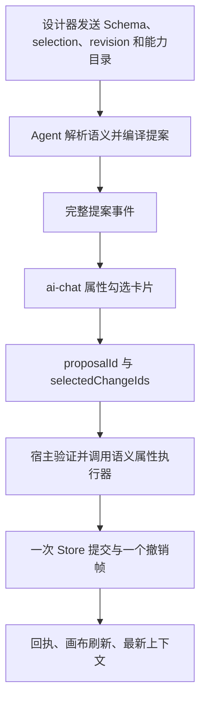

# 组件属性修改：ai-chat、设计器宿主接入待办与 Agent 输出协议

日期：2026-11-18  
协议状态：**三端接入契约**。Agent 1.2.0 已增加受控属性编译路径；ai-chat、设计器宿主仍需完成下列接入，不能直接交给旧解析器执行。实际 Agent 输入示例见 [property-context.example.json](./property-context.example.json)，Agent 包的功能与限制见 [README](../specialized-agent-package/README.md)。下列待办按三端整体交付列出，不表示 Agent 实现后宿主执行器也已就绪。

参考：[七类组件属性数据与 Agent 接入边界](./component-property-inventory.md)。宿主现状依据该清单记录的核验结果；实施前应结合宿主最新源码复核。

## 1. 目标和范围

让用户用自然语言查询或调整组件配置，由 Agent 生成可勾选的属性建议卡片，用户选择后，设计器将对应修改事务性应用到画布 Schema。

覆盖七类组件：`Input`、`Input.TextArea`、`NumberPicker`、`DatePicker`、`TimePicker`、`SelectSingle`、`SelectMulti`。

能力范围：

- 修改、查询、清空属性，恢复默认或继承。
- 新增、修改、删除受支持的校验规则。
- 复制指定属性到兼容组件。
- 条件显隐等宿主已注册联动。
- 撤销一次明确的应用事务。
- 兼容同义词、口语和常见错别字；目标或语义不明确时追问。

**本次文档的主要执行协议是修改属性。** 查询、独立规则、复制和撤销另列待办，不假定已经支持，也不借用修改属性载荷伪装支持。

应用成功只代表画布状态已更新，不代表已经保存到服务端。

## 2. 三端职责与协议分层

| 层级 | 职责 | 禁止混用 |
| --- | --- | --- |
| Agent | 识别意图、解析目标和语义值、澄清、编译受控提案 | 不生成持久化 ID，不直接操作 Store，不宣称已应用 |
| ai-chat | 接收完整产物、展示卡片、维护勾选状态、提交选择、呈现回执 | 不根据中文文案解析动作，不把展示数据当成画布 Schema |
| 设计器宿主 | 提供真实上下文、验证能力、执行属性 helper、原子提交、撤销、保存 | 不直接 spread 任意模型属性，不跳过保存锁、引用检查和 revision 检查 |

数据链路：



复用现有 `form-agent.v1` 信封和 `form.proposal.completed` 事件名；新增：

- `contractVersion = form_property_proposal.v1`
- `presentation.kind = component_property_checklist`
- `result.schemaVersion = form_property_actions.v1`
- `action = form.apply_property_change`

这些版本字符串属于建议命名。两端应先协商支持版本；旧的 `form_field_list`、`form_actions` 路径继续按原契约处理。这里的 `append` 表示增量应用，不表示将卡片列表或字段列表追加到旧列表。

## 3. ai-chat 待办清单

### P0：属性勾选闭环

- [ ] 按 `contractVersion` 和 `presentation.kind` 路由到新的属性卡片，未知版本显示不支持，不尝试旧解析器兜底。
- [ ] 校验完整 JSON、状态、必填字段、唯一 ID、change/action 对应关系及支持的动作版本。
- [ ] 实现卡片标题、逐项复选框、全选/半选、应用按钮、换一换及状态提示。
- [ ] `selectedByDefault` 仅用于初始化；后续重渲染不覆盖用户手动勾选。
- [ ] 将用户明确要求的操作与额外建议区分；额外建议默认不勾选。
- [ ] 每行对应一个完整语义操作；默认值模式和值、access 联动不能拆成独立叶子键勾选。
- [ ] 展示派生影响，例如“必填，同时开启显示和编辑”；展示继承值与局部覆盖的区别。
- [ ] 以 `changeId` 维护选中集合；提交 `selectedChangeIds`，不复用新增字段的 `selectedClientRefs`。
- [ ] 空选择时禁用应用；应用过程中防重复点击；失败后保留选择和具体错误。
- [ ] 有依赖时提示用户一并选择；不静默增加用户未选择的修改。
- [ ] 同节点同属性的互斥设置阻止应用；不能采用最后一项覆盖来掩盖冲突。
- [ ] 应用回执成功后显示实际结果及“尚未保存”；保存状态由宿主真实回执驱动。

### P0：流式接收与生命周期

- [ ] 流式阶段显示进度；完整提案到达前不提供可执行卡片。
- [ ] 接收 `form.proposal.completed` 完整载荷；若平台只交付标准步骤完成事件，接入等价最终 output 通道。
- [ ] 两个通道同时到达时去重；同一 `proposalId` 的内容指纹不一致时拒绝覆盖。
- [ ] SSE 重连按事件 ID 去重；取消、截断、失败不产生可应用结果。
- [ ] “换一换”先获取最新上下文，再生成新 `proposalId`；旧卡片标记为被替换并禁止继续应用。
- [ ] 卡片目标固定为生成时的节点，不随用户切换选中组件而改变。
- [ ] 已应用提案不能换一组 changeId 再次执行；希望应用剩余项时基于新 revision 生成新提案。

### P1：其他意图

- [ ] 查询卡片只读展示存储值、有效值、来源和读取时 revision，不带修改按钮。
- [ ] 澄清交互支持目标选择、属性含义选择、规则参数补充，并绑定待澄清请求。
- [ ] 复制属性展示来源、目标、兼容性和拟复制值，不复制组件身份信息。
- [ ] 重置卡片逐项列出恢复值、删除局部覆盖及保留内容，不使用含糊的“一键全部重置”。
- [ ] 撤销入口绑定具体应用事务，显示可撤销状态；不按历史聊天文字构造反向补丁。

## 4. 表单设计器宿主待办清单

### P0：上下文和机器可读属性目录

- [ ] 每轮提供最新 `currentSchema`、`target.schemaId`、`target.revision`、`selection.nodeId`。
- [ ] 提供节点组件类型、保存状态、系统字段限制、Flow/Grid、设备和实际可写能力。
- [ ] 将属性清单转为机器可读注册表：语义属性、别名、类型、枚举、范围、长度、写入条件、默认值、清空/重置方式、处理器 ID。
- [ ] 区分新增属性和已有组件修改能力；`name`、`identifiers` 不列为已有字段修改能力。
- [ ] 能力目录带 `catalogVersion`；应用时版本不一致则要求刷新，不继续使用旧语义。
- [ ] 提供属性存储状态和解析后的有效值；局部键缺失不能与 false、null、空字符串混淆。
- [ ] 白名单缺失或属性未知时默认拒绝，不能把未声明当成无限制。

### P0：统一语义属性执行器

- [ ] 实现 `form.apply_property_change`，按组件、语义属性和 operation 分派到注册处理器。
- [ ] 普通标量验证类型、有限数值、枚举、范围、字符串长度；不能从 defaultProps 的 typeof 推断完整类型。
- [ ] 权限复用 `applyAccessToggle`：required/edit/display/disableManualEdit 映射到 access，并同步必要兼容字段。
- [ ] 默认值复用 paired helper；设置时维护模式和值，清空时显式删除无效静态值。
- [ ] 文本长度以 `textLengthLimit` 语义成组维护 `showLimitHint` 和 `textMaxLength`。
- [ ] 下拉默认值同步 `options.dataSource[].activeKey` 与 `defaultValue`，检查值存在、启用状态和单选约束。
- [ ] 选项编辑保留 primaryKey、业务 value、目录及父子关系，删除前执行引用检查；未完成前保留已保存字段禁止 AI 修改的限制。
- [ ] 日期仅在 format 真正改变时执行派生更新；普通描述修改不得重置 placeholder。
- [ ] 日期时间范围按 source 规范化分支；验证引用、同类字段和上下界。
- [ ] relatedField 专用处理器同步节点绑定和表单 relatedFields；缺少远程元数据时不开放。
- [ ] `unset` 恢复局部布局继承；`clear` 与 `reset` 按属性分别实现，不能统一写 null/0/false。
- [ ] 严格执行保存锁和布局条件；条件属性基于整批最终候选状态验证。
- [ ] 展示预览和实际应用复用相同处理器；预览在副本上运行，不修改真实 Store。

### P0：目标、并发、事务和回执

- [ ] 恢复并完成实际 schemaId/baseRevision 比较；不能只校验字段存在而跳过比较。
- [ ] revision 覆盖相关本地编辑，不仅是服务端保存版本；手工修改、撤销、重做也推进 revision。
- [ ] 应用时按固定 nodeId 定位并验证 componentName；不重新绑定当前 selection。
- [ ] 校验 before 语义快照及处理器读取的前置状态；继承值变化同样需要识别。
- [ ] 在 Schema 副本上执行选中项，验证最终候选状态，然后通过一次比较并提交写入 Store。
- [ ] 验证失败整批不提交，返回 changeId 和错误码；不出现半批成功。
- [ ] 一批应用产生一个撤销帧，并记录实际联动修改和事务 ID。
- [ ] 幂等绑定 applyRequestId 与请求指纹；同键同请求重试返回原回执，同键不同请求拒绝。
- [ ] 将 proposalId 标记为已消费；换 changeId 子集重放旧提案也拒绝。
- [ ] 提供实际已应用 changeId、新 revision、派生修改、unsaved 状态及撤销事务 ID。
- [ ] 接入现有保存链路，保存成功后以真实 Schema 和版本回读更新上下文。

### P1：规则、联动、查询、复制与撤销

- [ ] 查询走真实快照解析器，返回 source=local/inherited/default 和 resolvedValue。
- [ ] 内置校验优先复用 format、必填、上下界等配置；独立规则建立稳定 ruleId 和受控类型。
- [ ] 明确规则新增/替换/删除、提示文案、组合关系、重复规则处理和后端校验边界。
- [ ] 条件联动采用受控 AST 和真实字段引用，禁止执行模型生成的 JS/eval 字符串。
- [ ] 定义严格大于/大于等于、小数精度/输入校验的差别；宿主无表达能力时返回不支持。
- [ ] 唯一性检查接入真实服务后才宣告支持，不因 isUnique=true 就声称后端约束已生效。
- [ ] 复制校验源和目标快照、组件兼容性及引用迁移；跨表单能力未接通前明确拒绝。
- [ ] 重置排除 ID、name、identifiers、业务绑定及受保存锁保护的属性，范围必须可预览。
- [ ] 撤销基于真实事务历史；后续修改存在时使用宿主历史规则，不盲目执行旧反向补丁。

## 5. Agent 侧配套待办

- [ ] 将意图拆为 query/set/clear/unset/reset/copy/rule/linkage/undo，允许一句话含多项操作。
- [ ] 将“必添”等别名归一化为已注册语义属性；歧义依上下文澄清，不只依赖关键词。
- [ ] 使用宿主真实节点和选项 value，目标重名、不存在或 selection 为空时澄清。
- [ ] 值转换保留组件语义：文本默认值“1”为字符串，数字默认值为有限 number，0 是合法值。
- [ ] 不虚构 width、disabled、maxLength、labelAlign 或 rules 等当前组件未声明的字段。
- [ ] 只生成受控 IR；编译器生成稳定 changeId/actionId、展示文案和最终协议。
- [ ] before 从快照读取；预览由宿主同语义处理器验证，不能将模型推测的 after 当作已验证结果。
- [ ] 缺少动作、复合处理器或规则运行时能力时返回 unsupported；需要用户决定时返回 needs_clarification。
- [ ] 增加查询专用输出契约；查询成功不能伪装成 no_change 或可执行 ready 提案。
- [ ] 增加七组件、口语、歧义、错误值、依赖、重置、规则和回执相关回归用例。

## 6. 属性语义与底层 Schema 映射

| 语义属性 | 示例值 | 宿主执行效果 |
| --- | --- | --- |
| placeholder | `"请输入说明"` | 设置 props.placeholder |
| description | `"填写申请原因"` | 设置 props.extra |
| descriptionDisplay | `"text"` | 设置 props.extraType；检查布局覆盖 |
| required | `true` | access helper 更新权限联动和兼容 required |
| defaultValue（Input） | `{mode:"custom",value:"1"}` | 成对设置 defaultValueConfig/defaultValue |
| titleHidden | `true` | props.hideTitle=true |
| titleAlign | `"left"` | props.textAlign=left；unset 删除局部键恢复继承 |
| titlePosition | `"top"` | props.labelPosition=top；unset 恢复继承 |
| size | `"large"` | props.size=large，不写控件内部 middle |
| textLengthLimit | `20` | showLimitHint=true、textMaxLength=20 |
| formatValidation（Input） | `{format:"phone",message:"请输入手机号"}` | format=phone、formatMessage；不凭空生成 rules 数组 |

这张表定义建议的语义标识，完整范围仍由注册表决定。SelectSingle、SelectMulti 的默认值需要各自的联合类型，不能复用 Input 默认值结构直接写入。

操作含义：

| operation | 含义 | 示例 |
| --- | --- | --- |
| set | 设置语义值，必须有 value | size=large |
| clear | 清空内容或停用配置，由处理器定义 | 默认值模式设为字符串 undefined 并清静态值 |
| unset | 删除允许删除的局部覆盖 | 删除 textAlign，恢复表单继承 |
| reset | 恢复注册表定义的默认或继承 | size 恢复 medium |

clear/unset/reset 不携带 value。标题不能清空；已有字段 name 不能修改或清空。JSON 中不使用 JavaScript undefined，null 仅允许用于明确声明可空的语义。

## 7. Agent 最终输出 JSON 示例

这是**最终产物**，不是模型中间 IR。场景：调整“申请说明”的占位提示、默认值、必填、尺寸及标题对齐继承。示例 before 假定来自生成时快照；实际数据必须由编译器读取。

```json
{
  "protocol": "form-agent.v1",
  "contractVersion": "form_property_proposal.v1",
  "schemaVersion": "1.1.0",
  "catalogVersion": "component-properties.v1",
  "proposalId": "proposal-property-001",
  "requestId": "request-property-001",
  "status": "ready",
  "target": {
    "schemaId": "form-example",
    "baseRevision": "rev-10"
  },
  "summary": "调整申请说明字段的属性。",
  "diagnostics": [],
  "presentation": {
    "kind": "component_property_checklist",
    "title": "是否将申请说明字段的属性设置为：",
    "items": [
      {
        "changeId": "change-placeholder",
        "nodeId": "field-example",
        "property": "placeholder",
        "text": "设置占位提示为“请输入申请说明”",
        "selectedByDefault": true,
        "before": { "exists": true, "value": "" },
        "after": { "exists": true, "value": "请输入申请说明" },
        "actionIds": ["action-placeholder"],
        "dependsOn": [],
        "effects": []
      },
      {
        "changeId": "change-default",
        "nodeId": "field-example",
        "property": "defaultValue",
        "text": "默认值设置为“1”",
        "selectedByDefault": false,
        "before": { "exists": true, "value": { "mode": "undefined" } },
        "after": { "exists": true, "value": { "mode": "custom", "value": "1" } },
        "actionIds": ["action-default"],
        "dependsOn": [],
        "effects": ["同时设置默认值模式和内容"]
      },
      {
        "changeId": "change-required",
        "nodeId": "field-example",
        "property": "required",
        "text": "将字段设置为必填",
        "selectedByDefault": true,
        "before": { "exists": true, "value": false },
        "after": { "exists": true, "value": true },
        "actionIds": ["action-required"],
        "dependsOn": [],
        "effects": ["开启显示和编辑，并同步必填权限"]
      },
      {
        "changeId": "change-size",
        "nodeId": "field-example",
        "property": "size",
        "text": "设置该组件的大小为“大”",
        "selectedByDefault": true,
        "before": { "exists": true, "value": "medium" },
        "after": { "exists": true, "value": "large" },
        "actionIds": ["action-size"],
        "dependsOn": [],
        "effects": []
      },
      {
        "changeId": "change-align",
        "nodeId": "field-example",
        "property": "titleAlign",
        "text": "清除标题对齐的单独设置，恢复继承表单",
        "selectedByDefault": false,
        "before": { "exists": true, "value": "right" },
        "after": { "exists": false },
        "actionIds": ["action-align"],
        "dependsOn": [],
        "effects": ["有效对齐方式由表单配置决定"]
      }
    ]
  },
  "result": {
    "kind": "form_actions",
    "mode": "append",
    "schemaVersion": "form_property_actions.v1",
    "actions": [
      {
        "actionId": "action-placeholder",
        "action": "form.apply_property_change",
        "payload": {
          "nodeId": "field-example",
          "componentName": "Input",
          "property": "placeholder",
          "operation": "set",
          "value": "请输入申请说明"
        }
      },
      {
        "actionId": "action-default",
        "action": "form.apply_property_change",
        "payload": {
          "nodeId": "field-example",
          "componentName": "Input",
          "property": "defaultValue",
          "operation": "set",
          "value": { "mode": "custom", "value": "1" }
        }
      },
      {
        "actionId": "action-required",
        "action": "form.apply_property_change",
        "payload": {
          "nodeId": "field-example",
          "componentName": "Input",
          "property": "required",
          "operation": "set",
          "value": true
        }
      },
      {
        "actionId": "action-size",
        "action": "form.apply_property_change",
        "payload": {
          "nodeId": "field-example",
          "componentName": "Input",
          "property": "size",
          "operation": "set",
          "value": "large"
        }
      },
      {
        "actionId": "action-align",
        "action": "form.apply_property_change",
        "payload": {
          "nodeId": "field-example",
          "componentName": "Input",
          "property": "titleAlign",
          "operation": "unset"
        }
      }
    ]
  }
}
```

### 7.1 必须共同实现的约束

- `schemaVersion` 是画布 Schema 版本；`result.schemaVersion` 是动作协议版本，两者不能混用。
- 本版限定一行对应一个语义动作，即 actionIds 长度为 1；复合属性的多个底层效果全部封装在处理器内。
- changeId、actionId 各自唯一；每个动作恰好属于一行，禁止存在未展示动作或复用动作。
- changeId 在同一个 proposal 中稳定；换一换生成新 proposal，不依靠旧 changeId 复用授权。
- before/after 表示语义配置状态，exists=false 不带 value；有效继承值由解析器额外计算，不能误当成本地存储值。
- effects 是解释性展示，不能包含可执行表达式；宿主使用相同目录和处理器验证并补充实际派生影响。
- 先构造完整候选状态，检测互斥和条件，再生成预览；不能以任意执行顺序决定相互矛盾操作的结果。
- 非 ready 状态不携带可执行 result。needs_clarification 提供 question/choices；unsupported 提供 diagnostics；no_change 用于修改请求已经满足的情况。
- 当前基础协议保留不变；新增解析器、编译器和执行器完成前，宿主不得声明支持此版本。

## 8. 流式交付约定

建议最终业务事件载荷如下；proposal 位置放第 7 节完整 JSON 对象。

```json
{
  "event": "form.proposal.completed",
  "eventId": "event-property-001",
  "data": {
    "block_id": "form_proposal",
    "title": "组件属性修改建议",
    "status": "ready",
    "proposal": {}
  }
}
```

这里的空对象仅为位置说明，生产事件必须包含完整 proposal。eventId 可以位于平台 SSE 的 id 字段，按实际传输协议统一，不要求平台同时重复包装 event 字段。

原始 token 不直接当成卡片 JSON 使用。需要逐行预览时可另定义非执行预览事件，最终完整事件仍为唯一可应用依据。平台是否支持业务事件透传、重放和补发需要联调验证。

## 9. ai-chat 应用请求

用户选择占位提示、必填和尺寸后：

```json
{
  "proposalId": "proposal-property-001",
  "selectedChangeIds": [
    "change-placeholder",
    "change-required",
    "change-size"
  ],
  "expectedRevision": "rev-10",
  "applyRequestId": "apply-property-001"
}
```

宿主从本轮已校验提案登记表取得完整动作，不信任聊天侧临时传入的另一个动作集合。若产品允许编辑建议值，必须生成并重新校验一个新提案版本，不能只改卡片文案或原地修改已登记动作。

执行顺序：

1. 查提案，检查未被替换、未消费以及内容指纹。
2. 检查请求 revision 与提案 baseRevision、宿主当前 revision 一致。
3. 验证选中 ID 非空、唯一、存在，且依赖已满足。
4. 按 nodeId 查询真实节点，校验组件类型、目录版本、保存锁、布局和 before。
5. 在副本上运行处理器，检查最终状态、引用和所有派生影响。
6. 提交前再次比较 revision，成功后一次写 Store，生成一个历史帧并推进 revision。
7. 记录幂等回执、消费提案，向聊天和 Agent 上下文回传真实结果。

## 10. 宿主回执

### 10.1 应用成功

```json
{
  "status": "applied",
  "proposalId": "proposal-property-001",
  "applyRequestId": "apply-property-001",
  "appliedChangeIds": ["change-placeholder", "change-required", "change-size"],
  "schemaId": "form-example",
  "previousRevision": "rev-10",
  "revision": "rev-11",
  "transactionId": "transaction-property-001",
  "unsaved": true,
  "actualChanges": [
    { "nodeId": "field-example", "operation": "set", "path": ["props", "placeholder"], "value": "请输入申请说明" },
    { "nodeId": "field-example", "operation": "set", "path": ["props", "access", "visible"], "value": true },
    { "nodeId": "field-example", "operation": "set", "path": ["props", "access", "editable"], "value": true },
    { "nodeId": "field-example", "operation": "set", "path": ["props", "access", "required"], "value": true },
    { "nodeId": "field-example", "operation": "set", "path": ["props", "required"], "value": true },
    { "nodeId": "field-example", "operation": "set", "path": ["props", "size"], "value": "large" }
  ]
}
```

actualChanges 是宿主计算的实际差异；未改变的路径可以省略。此示例不是 JSON Patch，也不是 Agent 可任意发送的写入接口。完整 Schema 通过宿主最新上下文同步。

### 10.2 版本冲突

```json
{
  "status": "conflict",
  "proposalId": "proposal-property-001",
  "applyRequestId": "apply-property-001",
  "errorCode": "REVISION_CONFLICT",
  "expectedRevision": "rev-10",
  "actualRevision": "rev-12",
  "message": "画布已发生变化，请刷新组件状态后重新生成建议。",
  "appliedChangeIds": []
}
```

其他建议错误码：TARGET_NOT_FOUND、COMPONENT_TYPE_MISMATCH、PROPERTY_UNSUPPORTED、VALUE_INVALID、PROPERTY_LOCKED、DEPENDENCY_UNSATISFIED、BEFORE_MISMATCH、CATALOG_VERSION_MISMATCH、PROPOSAL_CONSUMED、IDEMPOTENCY_CONFLICT。除 revision conflict 外可返回 rejected，并附 changeId 和具体原因；整批不提交。

## 11. 如何改变画布 Schema

第 9 节只选择占位提示、必填、尺寸，因此：

- 更新目标节点 props.placeholder。
- 通过 access helper 开启 visible/editable/required，并维护兼容 required。
- 更新 props.size=large。
- 默认值及标题对齐保持原样，因为对应行未勾选。
- 节点 id、props.name、identifiers、选项身份、其他字段、布局和未知属性全部保留。

宿主在 Schema 副本上递归查找 nodeId，按当前支持的布局和节点范围执行。children 中的字段只有在目录明确声明支持时才允许编辑；能递归定位不等于已经支持容器或 Grid 编辑。提交 Store 后，画布和属性面板通过现有订阅刷新，不操作 DOM，也不使用聊天展示字段替换整份 Schema。

## 12. 验收清单

- [ ] 七组件的合法标量修改与属性面板得到一致结果；非法类型、范围和枚举被拒绝。
- [ ] “必添”“不能为空”“提示文字”等口语映射正确；“大一点”“加个规则”等歧义进入澄清。
- [ ] 仅应用勾选项，未选择项及所有无关配置保持不变。
- [ ] 必填与可见/编辑联动一致，默认值模式和值原子更新。
- [ ] showLimitHint/textMaxLength 成组生效，关闭长度限制语义明确。
- [ ] 数字默认值 0、文本默认值“1”、日期/时间格式和下拉默认项得到正确处理。
- [ ] 日期只改描述不影响自定义占位提示；保存锁无法绕过。
- [ ] unset 恢复继承，reset 与关闭功能不同；JSON 丢失 undefined 不影响清空语义。
- [ ] 空选择、依赖缺失、互斥修改、节点删除、组件变更均阻止整批应用。
- [ ] 生成后手动编辑、撤销或重做触发 revision conflict；不静默覆盖新状态。
- [ ] 重复点击、网络重试、双完成事件、SSE 重放不重复执行。
- [ ] 换一换后旧卡片不可应用；同提案不能分多个子集反复应用。
- [ ] 一次应用可按宿主历史规则一次撤销；保存并重开后属性和运行效果一致。
- [ ] 查询不修改 Schema；不支持的规则、联动或布局明确返回不支持。
- [ ] 唯一性、公式、关联字段等外部依赖能力只有联调通过后才出现在能力目录中。

## 13. 推荐交付顺序

1. **P0-A：目录与执行器。** 注册表、上下文、权限/默认值/标量处理器、校验、revision、事务。
2. **P0-B：卡片闭环。** 新输出契约、完整事件、勾选应用、幂等、回执、撤销帧和保存回读。
3. **P1-A：查询与恢复。** 只读查询、clear/unset/reset、兼容属性复制。
4. **P1-B：复杂规则与联动。** 稳定规则标识、受控条件结构、公式、关联字段及远程校验。

每个阶段仅声明已完成并验证的能力；不要一次将清单中所有属性都标记为可执行。

## 14. Agent 升级后设计器的维护流程

Agent、ai-chat、宿主分别升级，不能用 Agent 包版本替代能力协商。当前补丁 Agent 1.2.2 保持 `form_property_proposal.v1` / `form_property_actions.v1`，修正真实宿主成组语义与 stored 快照兼容。

| 更新内容 | 设计器需要做什么 | ai-chat 需要做什么 |
| --- | --- | --- |
| 同义词、错别字、提示词优化，输出契约不变 | 通常无需改代码，使用真实 context 回归旧案例 | 通常无需改代码，确认完整事件仍能解析 |
| 已有执行器对应的新属性或新组件 | 核对类型、范围、锁、布局、继承/默认/清空语义；通过测试后纳入目录和节点授权 | 确认中文展示、选中项与动作映射支持该语义 |
| 新复合属性或派生效果 | 先实现专用处理器、语义读取、预览与事务验证，再声明 capability | 不把 payload.value 与 after 简单等同；after 是处理后的语义配置状态 |
| 新动作、新卡片、破坏性协议变化 | 新增分派/执行与版本协商，未知动作拒绝，保留旧协议兼容路径 | 同步升级解析器、组件与 SDK 导出，未知版本不执行 |
| 规则、公式、远程校验、关联数据 | 接通真实运行时与服务、校验引用及权限后才开放 | 展示实际结果，不把提案生成当成规则已经生效 |

### 发布和验收步骤

1. 对比 Agent 输出契约、属性语义、动作版本及上下文字段变化；目录只包含当前宿主可执行的能力。
2. 有语义变化时同步处理器与解析值。`resolvedProperties[nodeId][property]` 使用 `stored`、`resolvedValue`、`source`；before 与 stored 一致，不能从显示值倒推原始配置。
3. 人类说明与机器条件分开：中文条件说明使用 `conditionDescriptions`，`conditions` 只允许依赖映射，不能把说明数组送给 Python 编译器当条件。
4. 更新 Agent 包并发布到目标平台；若 ai-chat 公共 API 变化，设计器必须安装含实际运行代码与类型的新 SDK，不能只强制断言类型。
5. 本地联调允许使用工作区内 vendor tarball 和 file 依赖；这不是 Registry 发布。正式部署若采用公司 Registry，发布已验证版本后再替换依赖引用并更新锁文件。
6. 自动验证真实 context → 生产 Python 编译器 → 完整流式事件 → 卡片勾选 → 真实 Store/回执 → 下一轮新 context；至少包含手工编辑冲突、重复应用、未勾选不改、clear/reset/unset、撤销及旧新增字段路径。
7. 单独验证保存回读；`applied + unsaved=true` 不能显示“已保存”。更新宿主能力目录和版本后，旧提案必须重新检查 revision、目录与前置状态。

不支持的 Grid、移动端、独立规则或外部服务应保持不支持；不要为了兼容新 Agent 提示词而直接扩充白名单。


### 1.2.2 的动作版本隔离

Agent 已修复同一上下文声明字段生成与属性编辑时的动作版本混选。`form_fields` 仅读取 `form.add_component` 的可用版本；旧增量批次使用所有实际动作的版本交集；属性动作仍要求精确 `form_property_actions.v1`。画布 schemaVersion 继续原样保留1.0.0/1.1.0，ai-chat/宿主需分别兼容这两个版本，不能把动作版本当作画布版本。
